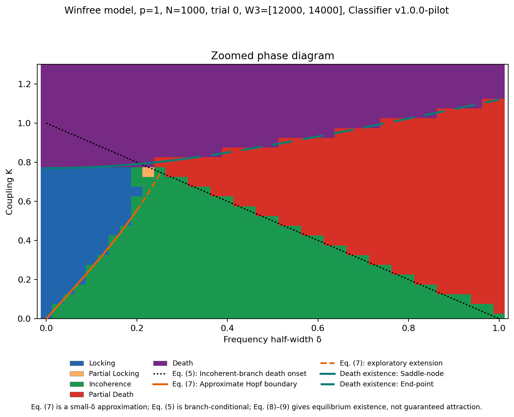

# Theoretical validation

The first block uses Classifier v2.0.0 on the completed Stage 1 p=1 grid: N=1000, trial 0, W3=[12000, 14000], 1741 profiles. Labels are rebuilt in memory from the local Stage 1 database. The ODE is not rerun, and the archived thresholds are not changed.

Later notes use the same Stage 1 profiles. Where a classifier label is required, the note states which classifier it used. `stage1_runs/` stays local.

The three checks are separate. A theoretical curve is not treated as the same object as a finite-time label change.

| Check | Boundary | Record |
| --- | --- | --- |
| Eq. (5) | Incoherent-branch onset, \(K=1-\delta\) | [eq5_partial_death](eq5_partial_death/eq5_validation_report.md) |
| Eq. (7) | Small-\(\delta\) Hopf truncation of the incoherent state | [eq7_hopf](eq7_hopf/eq7_validation_report.md) |
| Eq. (8)–(9) | Death equilibrium existence | [death_boundary](death_boundary/death_validation_report.md) |
| Overlay | The three curves on one zoomed phase diagram | [integrated_phase_diagram](integrated_phase_diagram/plot_integrated_phase_diagram.py) |

Eq. (7) is the printed product form, not the additive expansion. The solid orange piece is \(0<\delta\le 0.20\). The dashed orange piece continues only while \(K_H<1-\delta\). Eq. (5) is branch-conditional. Eq. (8)–(9) gives equilibrium existence, not attraction from every initial condition. Its saddle-node and end-point pieces are one boundary: the same teal, solid then dashed, joined at \(\delta_*\approx 0.2956\).

Each of those scripts reads the local Stage 1 database and writes only its own figure.

## Later checks

| Check | Record |
| --- | --- |
| Eq. (6) linear response at p=1, before the ER extension | [p1_hopf_linear_response](p1_hopf_linear_response/p1_hopf_linear_response_report.md) |
| Degree-based annealed Hopf correction to naive pK scaling | [er_annealed_hopf](er_annealed_hopf/er_annealed_hopf_report.md) |
| Eq. (5) against the annealed edge on the ER scans | [eq5_er_scaling](eq5_er_scaling/eq5_er_scaling_report.md) |
| Eqs. (6)–(9) against annealed pK scaling | [eq6789_er_scaling](eq6789_er_scaling/eq6789_er_scaling_report.md) |
| Those boundaries drawn on the Classifier v2 diagrams, including cells finished after the v2 archive | [full_grid_boundaries](full_grid_boundaries/full_grid_boundaries_report.md) |
| Incoherence labels above the Eq. (7) truncation | [incoherence_anomaly](incoherence_anomaly/incoherence_anomaly_report.md) |
| Quenched ER trajectories near the Hopf prediction | [quenched_hopf_pilot](quenched_hopf_pilot/quenched_hopf_pilot_report.md) |
